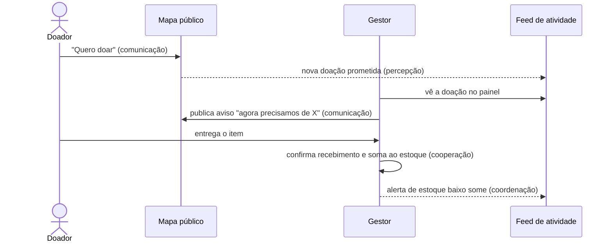

# Modelo 3C de Colaboração no sistema

O Modelo 3C (Fuks, Raposo e Gerosa, 2003) organiza a colaboração em **Comunicação**, **Coordenação** e
**Cooperação**, sustentadas por um **mecanismo de percepção**. A tabela mostra onde cada pilar existe hoje.

| Pilar | Quem colabora | Funcionalidade | Onde está |
|---|---|---|---|
| **Comunicação** | ponto → comunidade | Mural de avisos públicos ("precisamos de leite em pó"), exibidos no modal do ponto no mapa | `PointNotice` (`Audience = Public`), `GET /api/public/collection-points/{id}/notices` |
| **Comunicação** | gestor ↔ gestor | Mural da rede: avisos só para gestores, de todos os pontos | `Audience = Managers`, `GET /api/notices`, página **Mural de Avisos** |
| **Comunicação** | doador → ponto | "Quero doar": a pessoa avisa o que vai levar, com telefone opcional para combinar a entrega | `Donation`, `POST /api/public/collection-points/{id}/donations` |
| **Comunicação** | comunidade → ponto | Avaliações com nota e comentário, com denúncia | `Review`, `POST .../reviews` |
| **Coordenação** | rede de pontos | Histórico de retiradas compartilhado, para ninguém exceder o limite do ciclo somando vários pontos | `RegisterWithdrawalHandler`, `CountBeneficiaryWithdrawalsAsync` |
| **Coordenação** | gestor | Metas e avisos de estoque baixo por item; fila de doações aguardando entrega (`Pledged`) | `StockItem.Goal/AlertThreshold`, página **Doações** |
| **Coordenação** | papéis | `Admin`, `PointManager` e `Viewer`, com escopo por ponto | `CollectionPointScopeBehavior`, `IScopedToCollectionPoint` |
| **Cooperação** | doador + gestor | A doação recebida vira estoque na mesma operação (`ReceiveStock`) | `ReceiveDonationCommand`, `CollectionPoint.ReceiveStock` |
| **Cooperação** | pontos entre si | Beneficiário atendido por vários pontos, com vínculos (`BeneficiaryPointLink`) | `LinkBeneficiaryToPointCommand` |
| **Percepção** | gestor | Selo de doações pendentes no menu lateral, atualizado a cada minuto |  `usePointDonations`, `AppLayout` |
| **Percepção** | gestor | Feed de **atividade recente** do ponto: doações, avisos, avaliações e alertas de estoque, atualizado a cada minuto | `GetPointActivityFeedQuery`, `GET /api/collection-points/{id}/activity`, card no painel |

## Fluxo que amarra os três pilares

## Lacunas conhecidas

- **Não há notificação ativa** (e-mail, push, WhatsApp) quando uma doação chega: o gestor percebe pelo feed
  ao abrir o painel. O feed atualiza sozinho, mas só com a tela aberta.
- **Não há chat** entre doador e ponto. O contato é o telefone informado na doação.
- O mural não tem respostas nem comentários: é comunicação de um para muitos.
