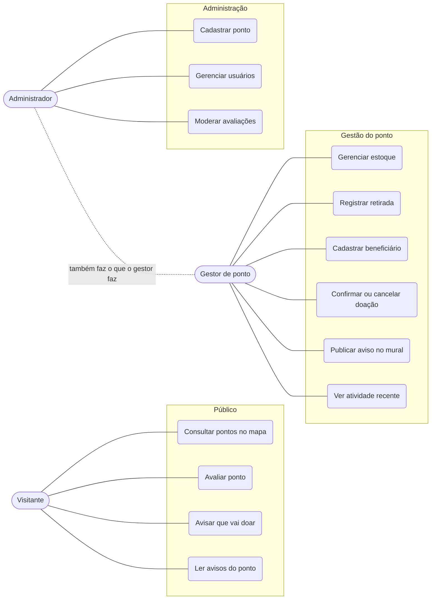
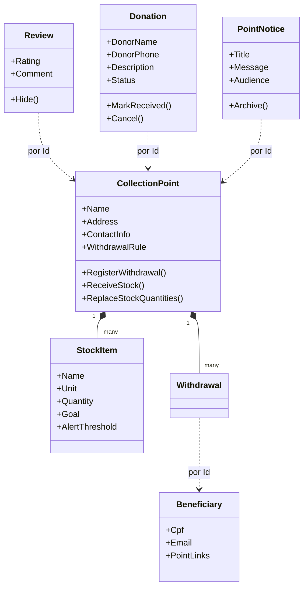
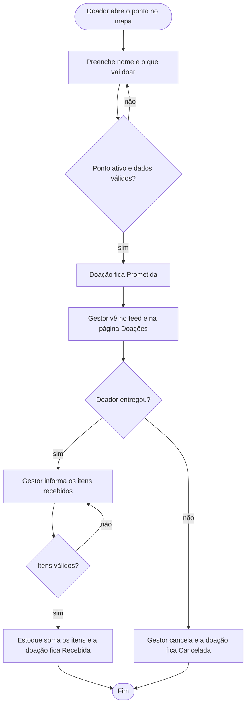
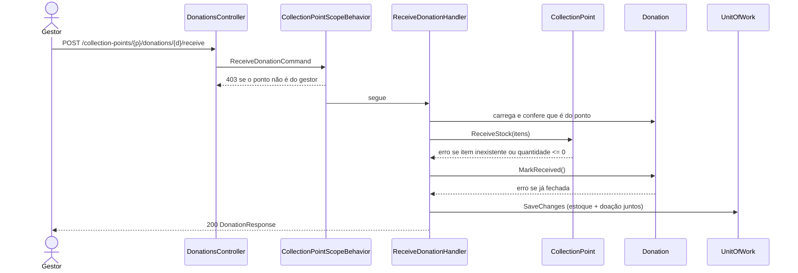

# Diagramas UML

## Casos de uso

## Modelo de domínio (agregados)

Linhas cheias são composição dentro do agregado; linhas pontilhadas são referências por Id entre
agregados (não há navegação EF entre eles).

## Atividades: ciclo de uma doação

## Sequência: confirmar recebimento

